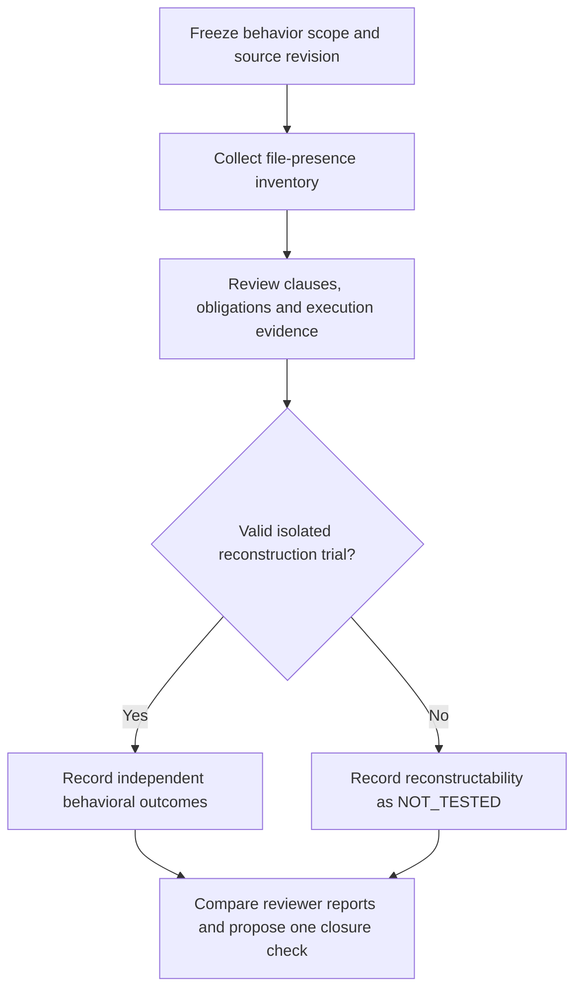

# GUIDO Scale

> From repository evidence to reviewable decisions — without turning file
> presence into a maturity score.

## Start here: three questions, three instruments

| Your question | Use | What you receive |
| --- | --- | --- |
| What evidence exists in this repo? | Executable `guido audit` | Eight file-presence checks; JSON and Markdown inventory |
| What can this evidence actually demonstrate? | Proposed [six-dimension diagnostics](SCALE.md) | Scoped observations, unknowns and actionable gaps; human review |
| How ready is our organization for SDD? | Organizational assessment below | Human organizational assessment; aggregation policy still needs reconciliation |

These instruments are not interchangeable. A repo with specs and green CI does
not automatically earn G4 or G5. The diagnostic proposal is format-agnostic:
SPECTRA, OpenSpec, BDD and API contracts can all supply relevant evidence.

## The evaluation journey



Inventory collection is automated. Substantive review, reconciliation and
reconstruction are not automatically performed by this CLI.
Follow the [repository evaluation guide](docs/evaluating-sdd-repositories.md)
and [calibration protocol](docs/calibration-v0.1.md).

### Read the evidence, not just the badge

| Evidence you have | Claim it supports | Claim it does not support |
| --- | --- | --- |
| A specification file exists | The scanner found a candidate artifact | The requirements are complete or correct |
| A reviewed trace annotation | A declared relationship exists | The implementation satisfies the rule |
| An authenticated passing test receipt | The named check passed in that run | Every behavior or environment is covered |
| A known seeded fault is caught | That control distinguishes that fault | General agent reliability or production readiness |
| No valid reconstruction trial | Reconstruction has not been evaluated | Reconstruction failed |

## Verify GUIDO itself

This is different from assessing a target repository. The proposed
`GUIDO Verify` workflow checks this project's code and documentation on PRs
and main, with one stable job name: `GUIDO verification`.

| Automated check | Boundary |
| --- | --- |
| Auditor and verifier unit tests | Tests the tooling, not an organization's maturity |
| Strict JSON and diagnostic-schema checks | Checks structure, not evidence authenticity |
| Internal Markdown file targets | No web URL, anchor or rendered-diagram verification |

```sh
python -m pip install -r requirements-ci.txt
PYTHONPATH=src python -m unittest discover -s tests -v
python scripts/verify_repository.py
```

Making the check **required for merge** is a separate administrator setting;
the workflow does not enforce branch protection by itself.
See [CI setup](docs/ci-verification.md) and [change history](CHANGELOG.md).

The organizational model below remains separate from the diagnostic proposal.
Its differing aggregation rules have not been reconciled by this change.

## Run the first agent

The `sdd-auditor` inventories repository evidence without changing the target:

```bash
python -m pip install -e .
guido audit /path/to/repository --output-dir /tmp/guido-audit
```

It writes `audit.json` and `audit.md`. This inventory does not assign an
organizational GUIDO level. See [the agent guide](docs/sdd-auditor.md) and
[its contract](agents/sdd-auditor/agent.yaml).

# GUIDO Scale  
## A Maturity and Migration Effort Model for Specification-Driven Development (SDD)

The **GUIDO Scale** is a unified maturity and migration effort framework designed to help organizations assess their readiness for adopting **Specification-Driven Development (SDD)** in modern **AI-agentic software engineering environments**.

This model combines two critical dimensions often treated separately:

- Organizational process maturity
- Effort required to migrate toward AI-driven specification-centric development

---

## Why the GUIDO Scale?

The rapid rise of AI agents in software engineering is shifting development from a **code-centric paradigm** to a **specification-centric paradigm**.

Organizations face a fundamental challenge:

> How ready are we to transition to Specification-Driven Development, and how difficult will that migration be?

Traditional maturity models such as CMMI measure process capability but do not address transformation effort toward AI-native engineering.

The GUIDO Scale fills this gap.

---

## What the GUIDO Scale Measures

The framework evaluates:

- Process discipline
- Documentation maturity
- Governance structures
- Automation capabilities
- Cultural readiness for AI integration
- Migration complexity toward SDD

---

## What Does GUIDO Stand For?

**G**overnance **U**nified **I**ntegration and **D**evelopment **O**rchestration

A framework that unifies two dimensions often treated separately — organizational maturity and migration effort — into a single model for navigating the transition toward AI-native, specification-driven software engineering.

The name also honors the author's commitment to making this framework a living, community-driven reference — not a static document.

---

## The Problem This Solves

Existing maturity models like CMMI answer one question well:
**"How mature are our engineering processes?"**

But they cannot answer what organizations actually need to know right now:
**"How hard will it be for us to migrate toward AI-agentic, specification-driven development — and where do we start?"**

These are two different questions. CMMI answers the first. GUIDO answers both simultaneously.

---

## What Makes GUIDO Different from CMMI

| Dimension | CMMI | GUIDO Scale |
|---|---|---|
| Primary focus | Process capability | Migration readiness toward SDD |
| AI-native context | Not addressed | Core design principle |
| Migration effort | Not measured | Explicit per level |
| Spec-driven practices | Not evaluated | Central assessment axis |
| Output | Maturity level | Maturity level + transformation roadmap |

GUIDO does not replace CMMI. It extends it for the AI-agentic era.

An organization can be CMMI Level 3 and still face very high migration effort toward SDD — because process maturity and specification-driven readiness are not the same thing.

---

## The Two Dimensions GUIDO Combines

**Dimension 1 — Organizational Maturity**
How disciplined, documented, and governed are your engineering processes today?

**Dimension 2 — SDD Migration Effort**
How much transformation work is required to shift from your current paradigm to specification-centric, AI-orchestrated development?

Most organizations optimize for Dimension 1 and ignore Dimension 2 until they try to adopt AI tools and fail.

---

## The Five GUIDO Levels

### GUIDO 1 — Chaotic State
**Effort: Very High**

- Minimal documentation
- Reactive processes
- High reliance on individual knowledge
- No standardized workflows

Processes are reactive and undocumented. Knowledge lives in individuals, not systems. Introducing AI agents here accelerates chaos, not delivery. Before adopting SDD, foundational engineering discipline must be established.

*Key signal:* "We figure things out as we go."

---

### GUIDO 2 — Initial Directed State
**Effort: High**

- Project-level documentation
- Partial governance
- Inconsistent process adoption

Project-level documentation exists but is inconsistent across the organization. Some governance is present but not enforced. AI can be introduced in controlled pilot environments, but significant cultural and process investment is required first.

*Key signal:* "Each team does it differently."

---

### GUIDO 3 — Defined Standards State
**Effort: Moderate**

- Organization-wide standards
- Structured documentation practices
- Consistent engineering methodologies
  
Organization-wide engineering standards exist and are followed. Documentation practices are structured. This is the most common entry point for realistic SDD adoption. Existing templates and processes can be adapted — not replaced — to become machine-readable specifications.

*Key signal:* "We have standards. Not everyone loves them, but we follow them."

---

### GUIDO 4 — Quantitatively Managed State
**Effort: Low**

- Metrics-driven engineering
- Strong automation pipelines
- Mature governance and compliance controls

Engineering is metrics-driven with mature automation and compliance controls. Teams likely already practice BDD or TDD. Migrating to SDD requires targeted training and tooling integration, not process reinvention. AI agents can be trusted with broader scope under human governance.

*Key signal:* "We measure everything. We know when something breaks before users do."

---

### GUIDO 5 — SDD-Native State
**Effort: Minimal**

- Specification-centric workflows
- AI-orchestrated development environments
- Continuous specification evolution
- Fully AI-native engineering processes

Specifications are the living source of truth. AI agents operate within governed pipelines. The organization evolves specifications continuously alongside code. Human engineers act as specification designers, orchestrators, and quality governors — not code producers.

*Key signal:* "Our specs drive our system. The code is a consequence."

---

## Applications

The GUIDO Scale can be used for:

- AI transformation strategy planning
- Engineering maturity assessment
- SDD adoption roadmapping
- Digital modernization initiatives
- Enterprise architecture governance
- Risk analysis for AI integration

---

## How to Use the GUIDO Scale

**Step 1 — Assess your current level**
Use the `/assessment` folder to evaluate your organization across six dimensions: process discipline, documentation maturity, governance structures, automation capabilities, cultural readiness, and specification practices.

**Step 2 — Identify your gap**
The distance between your current GUIDO level and GUIDO 5 defines your transformation roadmap, not just your maturity score.

**Step 3 — Plan incrementally**
Do not attempt to jump from GUIDO 1 to GUIDO 5. Each level has prerequisite capabilities. The model is designed for incremental, sustainable adoption.

---
## What Happens When Organizations Skip Levels

Organizations that attempt SDD adoption without the corresponding GUIDO level readiness typically experience:

- AI agents generating technically correct but architecturally inconsistent code
- Specification drift — code diverging from specs within weeks
- Increased technical debt velocity, not reduced
- Team resistance to AI tools due to unpredictable outputs

**AI amplifies what already exists. If your process is disciplined, AI accelerates quality. If it is not, AI accelerates chaos.**

---

## Real-World Scenarios

### Scenario A — Financial Services Company (GUIDO 1 → 3)
**Context:** A mid-size bank with 80 developers. No standardized documentation. Requirements live in email threads and verbal agreements. Attempted to adopt GitHub Copilot — adoption failed within 60 days.

**Diagnosis:** GUIDO 1. AI amplified inconsistency rather than productivity.

**Migration path:**
- Months 1–3: Establish version-controlled requirements. Introduce SPEC.md templates per team.
- Months 4–6: Pilot SDD on one non-critical module. Human-in-the-loop validation at every spec checkpoint.
- Months 7–12: Reach GUIDO 3. Expand SDD to two additional product lines.

**Key lesson:** The Copilot failure was not an AI problem. It was a GUIDO 1 problem.

---

### Scenario B — SaaS Startup (GUIDO 3 → 5)
**Context:** A 25-person product team already practicing BDD with Cucumber. Clear acceptance criteria per story. CI/CD pipeline mature. Wanted to accelerate feature delivery using AI agents.

**Diagnosis:** GUIDO 3. Strong foundation. Low migration resistance.

**Migration path:**
- Month 1: Convert existing BDD specs into structured SPEC.md artifacts compatible with AI agents.
- Month 2: Introduce an orchestrator agent for code generation on isolated features.
- Months 3–4: Reach GUIDO 4. Measure: defect rate, spec drift, delivery time.
- Month 6: Specs become the primary interface between product and engineering. GUIDO 5.

**Key lesson:** BDD practitioners are the natural early adopters of SDD. The bridge is shorter than they think.

---

### Scenario C — Enterprise Stuck at GUIDO 2
**Context:** A logistics company with CMMI Level 3 certification but siloed documentation. Each department maintains its own format. Engineering and product rarely share a common spec language.

**Diagnosis:** GUIDO 2, despite CMMI Level 3. This is the most common mismatch: high process maturity, low SDD readiness.

**Migration path:**
- Phase 1: Unify specification language across product, engineering, and QA.
- Phase 2: Introduce a shared spec repository as a single source of truth.
- Phase 3: Pilot one AI agent on internal tooling, not customer-facing systems.

**Key lesson:** CMMI level and GUIDO level are not the same. You can be formally mature and still face high SDD migration effort.

---

## Applications

The GUIDO Scale can be used for:

- AI transformation strategy planning
- Engineering maturity assessment
- SDD adoption roadmapping
- Digital modernization initiatives
- Enterprise architecture governance
- Risk analysis for AI integration

---

## Relationship to Existing Models

The GUIDO Scale complements traditional frameworks such as CMMI, DevOps Maturity Models, and Digital Transformation Frameworks. It specifically focuses on **migration toward AI-agentic software development** — a dimension none of those models address explicitly.

---

## Full Documentation

📄 [GUIDO Scale Whitepaper](/whitepaper/GUIDO-Scale-Whitepaper.md)
📋 [Assessment Tool](/assessment/)
📚 [Detailed Docs](/docs/)

---

## Author

**Guido Miranda Mercado**  
Senior Quality Engineering Leader  
AI-Driven Software Quality Strategist  

---

## How to Cite

If you use or reference this model, please cite:

Miranda, G. (2026). *GUIDO Scale: A Maturity and Migration Effort Model for Specification-Driven Development*. GitHub Repository.  
https://github.com/GuiMiran/guido-sdd-migration-effort-scale

---

## License

© 2026 Guido Miranda Mercado  

This work is licensed under the **Creative Commons Attribution 4.0 International License (CC BY 4.0)**.

You are free to share and adapt this work provided proper attribution is given.

---

## Contributions

Contributions, discussions, and improvements are welcome.

Please open an issue or submit a pull request.

---

## Vision

The GUIDO Scale aims to become a reference framework for organizations navigating the transition toward **AI-native software engineering** and **Specification-Driven Development**.

## License

This project is licensed under the Creative Commons Attribution 4.0 International License (CC BY 4.0).

© 2026 Guido Miranda Mercado
